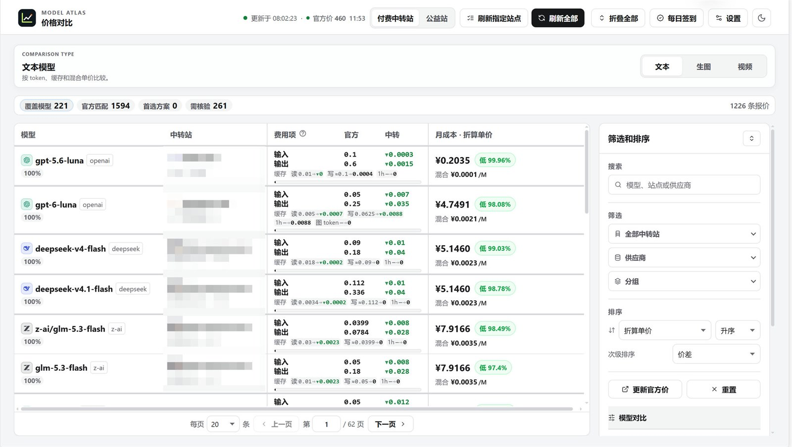
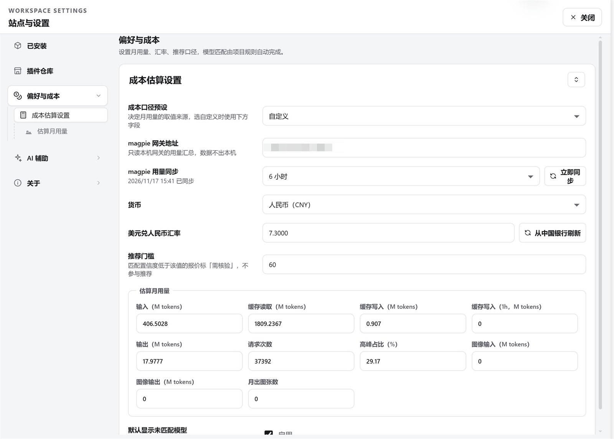
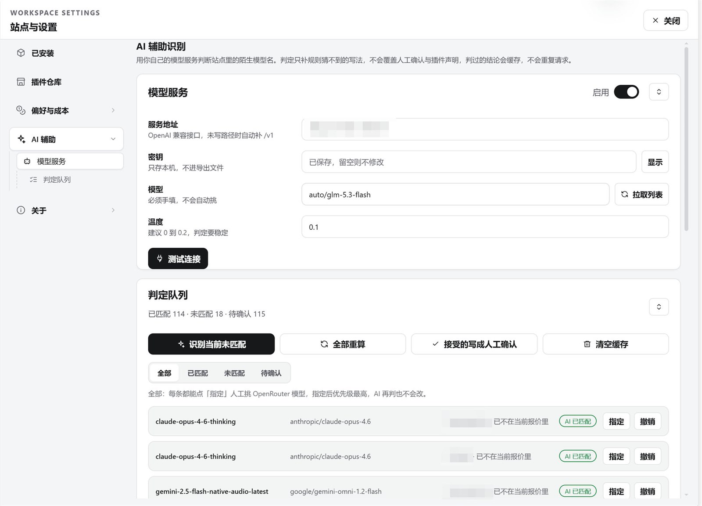

<p align="center">
  
</p>
<h1 align="center">AI Price Analyzer</h1>

<p align="center">Compare AI gateway prices and estimate costs with your own usage.</p>

<p align="center">
  <a href="./README.md">简体中文</a> |
  <a href="./README.en.md">English</a>
</p>

<p align="center">
  <a href="https://github.com/napstablook666/ai-price-analyzer/actions/workflows/ci.yml"></a>
  <a href="https://github.com/napstablook666/ai-price-analyzer/releases"></a>
  <a href="./LICENSE"></a>
  <a href="https://napstablook666.github.io/ai-price-analyzer/"></a>
  <a href="https://linux.do/"></a>
</p>

The same model can have different names across AI gateways. Top-up ratios, group multipliers, and cache prices also affect what you pay. AI Price Analyzer collects prices from the stations you add, matches their model names, and estimates costs with the same usage figures so you can compare offers without switching between pricing pages.

It is a Chromium Manifest V3 extension for browsers such as Chrome and Edge. Download it and load the extracted directory. No backend deployment or Node.js installation is needed to use it.

[Download](https://github.com/napstablook666/ai-price-analyzer/releases) · [Installation guide](./docs/guide/install.md) · [Documentation](https://napstablook666.github.io/ai-price-analyzer/)

## What it does

| What you want to know | How the extension helps |
| --- | --- |
| Which station charges less for the same model | Matches different names to a common model identity while keeping station, group, and billing conditions separate. |
| What your usage might cost in a month | Prices input, output, and cache reads and writes separately, using the configured top-up ratios, group multipliers, and billing tiers. |
| How image and video prices compare | Keeps text, image, and video comparisons separate, with per-request, per-image, and per-second units preserved. |
| How to avoid entering usage repeatedly | Can read the last 30 days of usage from a local magpie gateway, every 6 hours by default. Manual entry is also available. |
| What to do with unfamiliar model names | Can use your own OpenAI-compatible service for assistance. Review or revoke verdicts; manual assignments always take priority. |
| How to add a station | Install a site adapter from the plugin registry or contribute a collection rule using the plugin protocol. |

## Preview

### Price comparison

Compare offers for a model across stations and groups. Filters, sorting, and monthly-cost bars help show the differences while each offer keeps its source and billing conditions.



### Usage and cost estimates

Enter input, output, and cache usage to estimate costs at each station. If you run a local magpie gateway, you can sync the last 30 days of usage instead.



### Assisted model matching

Review unmatched names, AI verdicts, and manual assignments. Valid AI verdicts are cached for matching and can be revoked or replaced with a manual assignment; they do not automatically become manual overrides.



The screenshots show the interface and workflow. Their prices are examples of collected data, not current quotes; refresh before comparing.

## Install

Use Chrome, Edge, or another Chromium browser with Manifest V3 support. The current version is recorded in [manifest.json](./manifest.json).

1. Download `ai-relay-price-extension-v<version>.zip` from [Releases](https://github.com/napstablook666/ai-price-analyzer/releases).
2. Extract it to a permanent directory with `manifest.json` directly inside it.
3. Open `chrome://extensions`, or `edge://extensions` in Edge, and enable **Developer mode**.
4. Select **Load unpacked**, choose that directory, and pin the extension to the toolbar.

Installing from source does not require a build either. Clone the repository and load its root directory.

```bash
git clone https://github.com/napstablook666/ai-price-analyzer.git
cd ai-price-analyzer
```

See the [installation guide](./docs/guide/install.md) for more detail.

## Quick Start

1. Click the extension icon to open the dashboard, then use the gear to open station settings.
2. Install a site plugin from the registry and add the station from the installed list. You can also enter a station URL and use station analysis to identify its configuration.
3. Check the collection method, authentication, and top-up ratio. Save and refresh. If prompted, sign in to the station in the current browser and retry.
4. Return to the dashboard, choose a model, and review offers across stations and groups, including their matching status.
5. Open the cost estimate settings under preferences and cost. Enter usage or sync the last 30 days from your local magpie gateway, then compare monthly costs.

Start with one station and confirm that collection works before adding the rest. See [station fields](./docs/configuration/station-fields.md) for configuration and the [dashboard guide](./docs/guide/dashboard.md) for reading results.

## Updating

- In settings, open the About section, bind the extension directory for one-click updates, and apply an available update. Updates verify the release manifest signature and file hashes.
- On Windows, you can also run `update.bat` from the extension directory.
- Manual updates remain available. Extract a new release over the existing directory and reload the extension in the browser. For a source checkout, run `git pull` and reload.

When migrating from a version before 0.9.0, the extension ID change may prevent direct access to old data. Export the configuration from the About section before migrating, then import it after installation. Keys are excluded from exports and must be entered again.

## Data and permissions

Settings, collected snapshots, and matching results stay in browser storage. This project does not operate a server-side account or analytics service. Stations that need authentication use the browser session or credentials you configured, according to their adapter.

- Prices come from your configured stations. Public reference prices and exchange rates come from [OpenRouter](https://openrouter.ai/api/v1/models) and the [Bank of China](https://www.boc.cn/sourcedb/whpj/).
- By default, the extension attempts to read usage summaries from a local magpie gateway. You can turn off syncing in settings. When enabled, assisted matching sends model names and candidate information to the model service you configure.
- Plugin indexes and update resources use the project's GitHub resources. Station and model service keys are stored locally and excluded from configuration exports.
- The extension declares `storage`, `scripting`, `tabs`, `alarms`, `cookies`, `declarativeNetRequest`, and `<all_urls>` host permission to support stations added by the user. Page collection operates on configured stations.

Keep cookies, keys, authorization headers, and private API responses out of issues, pull requests, and screenshots. See [PRIVACY.md](./PRIVACY.md) for details and [SECURITY.md](./SECURITY.md) for vulnerability reporting.

## Limitations and disclaimer

**Prices and cost estimates are for reference only. Actual charges depend on the station's billing rules and invoice.**

- Collection records the prices visible at the time. Refresh or check your configuration when currencies, top-up offers, groups, or billing tiers change.
- Monthly costs depend on the usage you enter or sync. Results marked `≈`, estimated, derived price, or currency unverified need additional checking.
- Model-name matching can be wrong and does not verify the identity or quality of the model actually served by a station.
- The project does not place orders, reconcile bills, or endorse a station's reputation, reliability, or service quality. Verify independently before topping up or purchasing.

Read the full [disclaimer](./docs/disclaimer.md).

## Documentation

| Task | Where to look |
| --- | --- |
| Install and get started | [Installation](./docs/guide/install.md), [Quick start](./docs/guide/quick-start.md) |
| Add stations and handle authentication | [Station fields](./docs/configuration/station-fields.md), [Sessions and tokens](./docs/guide/session.md) |
| Understand prices and monthly costs | [Dashboard](./docs/guide/dashboard.md), [Cost estimates](./docs/guide/cost.md) |
| Troubleshoot collection or results | [Troubleshooting](./docs/troubleshooting.md), [FAQ](./docs/faq.md) |
| Write plugins and understand data flow | [Plugin protocol](./docs/plugin-development.md), [Architecture](./docs/architecture.md) |
| Develop and release | [Development](./docs/development.md), [Contributing](./CONTRIBUTING.md) |
| Read the full manual | [User guide](./docs/user-guide.md), [Documentation site](https://napstablook666.github.io/ai-price-analyzer/) |

## Development and contributing

This repository contains the extension. Hand-written station adapters live in [ai-price-analyzer-plugins](https://github.com/napstablook666/ai-price-analyzer-plugins). Development and tests require Node.js 20 or newer; ordinary installation does not.

For plugin development, check out the two repositories side by side. Run these commands from their shared parent directory.

```bash
git clone https://github.com/napstablook666/ai-price-analyzer.git
git clone https://github.com/napstablook666/ai-price-analyzer-plugins.git plugins
cd ai-price-analyzer
npm run plugins:build
```

The builder reads `../plugins/` by default and generates runtime files under `src/site-plugins/` and related locations. Set `PLUGIN_DIR` if the plugin repository is elsewhere. Do not edit generated files by hand. Downloaded extension packages already include them.

Run the following commands from the extension repository root.

| Command | Purpose |
| --- | --- |
| `npm test` | Run all tests |
| `npm run verify` | Check DOM references, code constraints, tests, plugin drift, and version consistency |
| `npm run verify:clean` | Run acceptance checks in a clean checkout |
| `npm run plugins:build` | Regenerate runtime files after plugin changes |
| `npm run plugins:check` | Check generated plugin files for drift |
| `npm run models:lookup -- "claude 4.6"` | Look up a canonical model ID |
| `npm run models:build -- --offline` | Rebuild the canonical model table from local caches |
| `npm run docs:dev` | Preview the documentation site |

When reporting a problem, include the extension version, station name, reproduction steps, and a redacted screenshot. Read [CONTRIBUTING.md](./CONTRIBUTING.md) before submitting changes, and the plugin repository's [development guide](https://github.com/napstablook666/ai-price-analyzer-plugins/blob/main/DEVELOPMENT.md) for station adapters.

## License

[GPL-3.0](./LICENSE)
