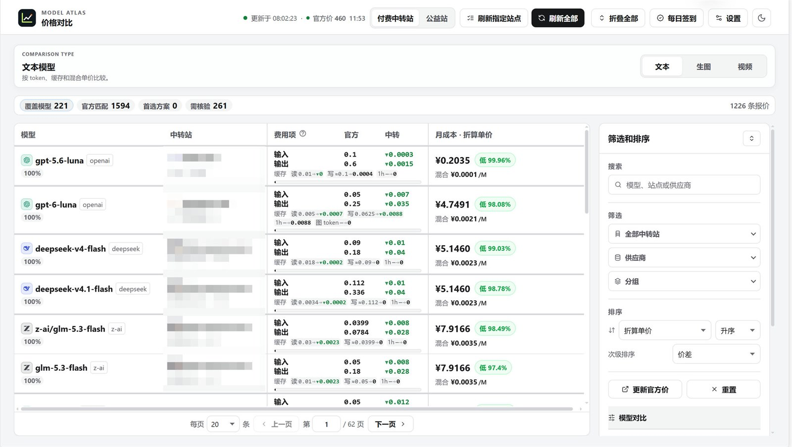
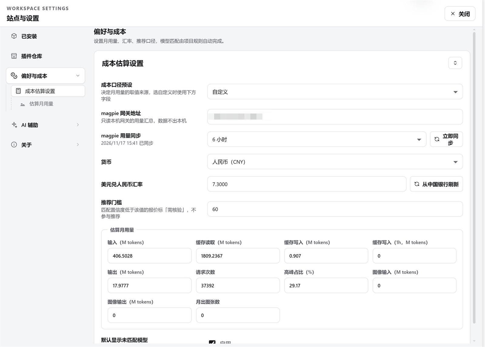
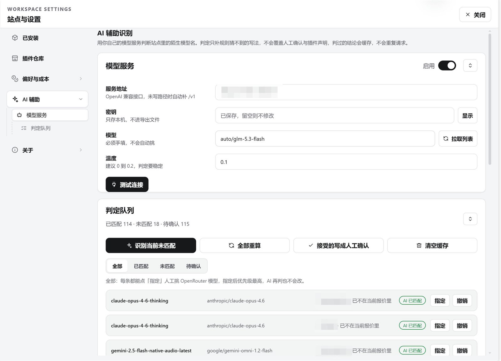

<p align="center">
  
</p>
<h1 align="center">AI Price Analyzer</h1>

<p align="center">比较 AI 中转站报价，按自己的用量估算成本。</p>

<p align="center">
  <a href="./README.md">简体中文</a> |
  <a href="./README.en.md">English</a>
</p>

<p align="center">
  <a href="https://github.com/napstablook666/ai-price-analyzer/actions/workflows/ci.yml"></a>
  <a href="https://github.com/napstablook666/ai-price-analyzer/releases"></a>
  <a href="./LICENSE"></a>
  <a href="https://napstablook666.github.io/ai-price-analyzer/"></a>
  <a href="https://linux.do/"></a>
</p>

同一个模型，各站的叫法可能不同，充值比例、分组倍率和缓存价格也得一起看。AI Price Analyzer 把你添加的站点报价收集到浏览器里，先对齐模型名，再用同一组用量估算各站成本，省去来回翻价目页、手动换算的麻烦。

它是一个 Chromium Manifest V3 扩展，支持 Chrome、Edge 等浏览器。下载后加载即可使用，不需要部署服务端，也不需要先装 Node.js。

[下载扩展](https://github.com/napstablook666/ai-price-analyzer/releases) · [安装指南](./docs/guide/install.md) · [在线文档](https://napstablook666.github.io/ai-price-analyzer/)

## 能做什么

| 你想看什么 | 扩展怎么处理 |
| --- | --- |
| 同一个模型在哪家更便宜 | 将不同写法匹配到统一模型身份，各站点、分组和计费条件分别展示。 |
| 按自己的用量，一个月要花多少 | 输入、输出和缓存读写分别计算，并计入已配置的充值比例、分组倍率与计费档位。 |
| 生图、视频怎么比 | 文本、图像和视频分开比较，保留按次、按张、按秒等计费单位。 |
| 不想反复填用量 | 可读取本机 magpie 网关最近 30 天的用量，默认每 6 小时同步，也能手动填写。 |
| 陌生模型名认不出来 | 可接自己的 OpenAI 兼容模型服务辅助识别，查看和撤销判定；人工指定始终优先。 |
| 想补一个站点 | 从插件仓库安装站点适配，或按插件协议补充采集规则。 |

## 预览

### 价格对比

按模型查看不同站点和分组的报价，用筛选、排序和月成本条比较差距。同一模型下的报价保留各自的来源与计费条件。



### 用量与成本估算

填入输入、输出和缓存用量，查看这组用量在不同站点的预计成本。使用本机 magpie 网关时，也可以直接同步最近 30 天的用量。



### 模型名辅助识别

查看未匹配的名称、AI 判定和人工指定。AI 的有效判定会缓存使用，需要时可撤销或改成人工指定，不会自动变成人工覆盖。



截图展示界面和操作方式，其中的报价不代表当前价格，使用时请重新采集。

## 安装

需要支持 Manifest V3 的 Chrome、Edge 等 Chromium 浏览器，当前版本见 [manifest.json](./manifest.json)。

1. 在 [Releases](https://github.com/napstablook666/ai-price-analyzer/releases) 下载 `ai-relay-price-extension-v<version>.zip`。
2. 解压到固定目录，确认里面直接能看到 `manifest.json`。
3. 打开 `chrome://extensions`，Edge 用户打开 `edge://extensions`，启用「开发者模式」。
4. 点击「加载已解压的扩展」，选择上一步的目录，然后将扩展固定到工具栏。

从源码安装也不需要构建，克隆后直接加载仓库根目录。

```bash
git clone https://github.com/napstablook666/ai-price-analyzer.git
cd ai-price-analyzer
```

更多安装说明见[安装指南](./docs/guide/install.md)。

## 快速开始

1. 点击扩展图标打开比价面板，通过齿轮进入「站点与设置」。
2. 在「插件仓库」安装需要的站点插件，再从「已安装」添加站点。也可以输入站点网址，用「分析站点」识别配置。
3. 核对采集方式、认证信息和充值比例，保存后点击「刷新全部」。遇到登录提示，在当前浏览器登录对应站点后重试。
4. 回到比价面板，选一个模型，查看各站点、分组的报价和匹配情况。
5. 在「偏好与成本 → 成本估算设置」填入用量，或同步本机 magpie 网关最近 30 天的用量，再比较月成本。

第一次使用，先加一个站点跑通采集。看到报价后，再补其他站点和成本参数。字段含义见[站点配置](./docs/configuration/station-fields.md)，表格读法见[比价面板](./docs/guide/dashboard.md)。

## 更新

- 在设置的「关于 → 一键更新」绑定扩展目录，检查到新版本后点击「立即更新」。更新会校验发布清单签名和文件摘要。
- Windows 用户也可以双击扩展目录里的 `update.bat`。
- 仍可手动下载新包覆盖原目录，再到浏览器扩展页重新加载。源码安装则使用 `git pull` 后重新加载。

从 0.9.0 以前的版本迁移时，扩展 ID 的变化可能导致旧数据无法直接读取。先在「关于 → 配置迁移」导出配置，安装后再导入；密钥不包含在导出文件中，需要重新填写。

## 数据与权限

设置、采集快照和判定结果保存在浏览器本地，本项目不运行服务端账户或分析服务。需要登录的站点会按对应适配规则使用浏览器会话或你配置的凭据。

- 价格来自你添加的站点页面或接口；公开参考价和汇率来自 [OpenRouter](https://openrouter.ai/api/v1/models) 与[中国银行](https://www.boc.cn/sourcedb/whpj/)。
- 默认会尝试读取本机 magpie 网关的用量汇总，可在设置中关闭同步。AI 辅助识别启用后，会向你配置的模型服务发送待识别名称和候选信息。
- 插件索引和版本更新使用项目的 GitHub 资源。站点与模型服务密钥保存在本机，不包含在配置导出中。
- 扩展声明 `storage`、`scripting`、`tabs`、`alarms`、`cookies`、`declarativeNetRequest` 及 `<all_urls>` 主机权限，以适配用户添加的不同站点。页面采集按已配置站点运行。

请勿将 Cookie、密钥、授权请求头或私人接口响应贴进 Issue、Pull Request 和截图。详细说明见 [PRIVACY.md](./PRIVACY.md)，漏洞反馈见 [SECURITY.md](./SECURITY.md)。

## 使用限制与免责声明

**价格与成本估算仅供参考，实际收费以站点的结算规则和账单为准。**

- 采集的是当时可见的价目。币种、充值优惠、分组和计费档位发生变化后，需要重新采集或核对配置。
- 月成本依赖你填写或同步的用量。带 `≈`、「估算」、「价格推导」、「币种待核验」标记的结果，需要额外核实。
- 模型名称匹配可能出错，也不能证明站点实际提供的模型身份或质量。
- 本项目不代下单、不核对账单，不为任何站点的信誉、稳定性或服务质量背书。充值和采购前请独立核实。

完整说明见[免责声明](./docs/disclaimer.md)。

## 文档

| 想做什么 | 看哪里 |
| --- | --- |
| 安装和上手 | [安装指南](./docs/guide/install.md)、[快速开始](./docs/guide/quick-start.md) |
| 添加站点、处理登录 | [站点字段](./docs/configuration/station-fields.md)、[登录态与 Token](./docs/guide/session.md) |
| 看懂报价和月成本 | [比价面板](./docs/guide/dashboard.md)、[成本估算](./docs/guide/cost.md) |
| 采集失败或结果不对 | [故障排查](./docs/troubleshooting.md)、[常见问题](./docs/faq.md) |
| 写插件、了解数据流 | [插件协议](./docs/plugin-development.md)、[架构说明](./docs/architecture.md) |
| 开发和发布 | [开发文档](./docs/development.md)、[贡献指南](./CONTRIBUTING.md) |
| 完整手册 | [用户指南](./docs/user-guide.md)、[在线文档站](https://napstablook666.github.io/ai-price-analyzer/) |

## 开发与贡献

扩展代码在本仓库，站点适配的手写源在 [ai-price-analyzer-plugins](https://github.com/napstablook666/ai-price-analyzer-plugins)。开发和测试需要 Node.js 20 及以上，普通安装不需要。

开发站点插件时，将两个仓库并排签出。以下命令从它们的共同父目录执行。

```bash
git clone https://github.com/napstablook666/ai-price-analyzer.git
git clone https://github.com/napstablook666/ai-price-analyzer-plugins.git plugins
cd ai-price-analyzer
npm run plugins:build
```

构建器默认从 `../plugins/` 读取源码，再生成本仓库的 `src/site-plugins/` 等运行时文件。插件仓库在其他位置时，用 `PLUGIN_DIR` 指向它；不要手改生成物。普通用户下载的扩展包已包含生成物。

以下命令在扩展仓库根目录运行。

| 命令 | 用途 |
| --- | --- |
| `npm test` | 运行全部测试 |
| `npm run verify` | 检查 DOM 引用、代码约束、测试、插件漂移和版本一致性 |
| `npm run verify:clean` | 在干净签出上运行验收 |
| `npm run plugins:build` | 修改插件后重新生成运行时文件 |
| `npm run plugins:check` | 检查插件生成物有无漂移 |
| `npm run models:lookup -- "claude 4.6"` | 查询规范模型 ID |
| `npm run models:build -- --offline` | 使用本地缓存重建规范模型表 |
| `npm run docs:dev` | 预览文档站 |

提问题时，请附上扩展版本、站点名称、复现步骤和脱敏截图。提交改动前看[贡献指南](./CONTRIBUTING.md)，站点适配另见插件仓库的[开发说明](https://github.com/napstablook666/ai-price-analyzer-plugins/blob/main/DEVELOPMENT.md)。

## 许可证

[GPL-3.0](./LICENSE)
