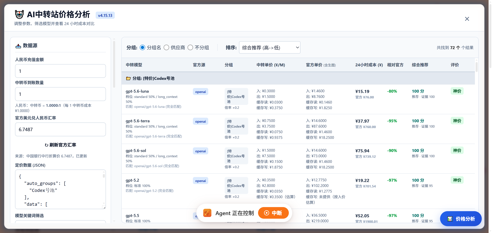
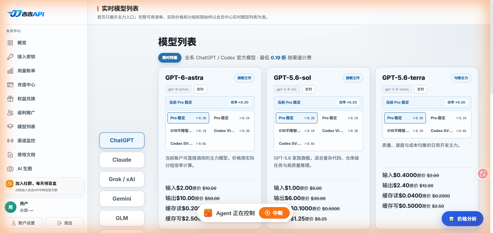

# AI Price Analyzer

<p align="center"><strong>在浏览器中对比 AI 中转站模型价格与 OpenRouter 参考数据。</strong></p>

<p align="center">
  <a href="./README.md">English</a> |
  <a href="./README.zh-CN.md">简体中文</a>
</p>

<p align="center">
  <a href="https://github.com/napstablook666/ai-price-analyzer/actions/workflows/ci.yml"></a>
  <a href="https://github.com/napstablook666/ai-price-analyzer/releases"></a>
  <a href="./LICENSE"></a>
</p>

AI Price Analyzer 是一个浏览器用户脚本，用于比较受支持 AI 中转站页面展示的模型价格。它可以读取当前页面或同源价格接口中的数据，匹配等价模型，并根据可配置的工作负载估算成本。

## 主要能力

| 能力 | 作用 |
|---|---|
| 页面与接口捕获 | 直接分析当前价格页面已有的数据，不需要维护单独的厂商数据库。 |
| OpenRouter 参考数据 | 在公开接口可访问时，与 OpenRouter 模型目录进行对比。 |
| 模型匹配规则 | 默认优先精确匹配，也可以启用后缀、版本号或模糊匹配。 |
| 工作负载估算 | 输入请求数和 Token 用量，对比预计的 24 小时或月度成本。 |
| 本地保存 | 通过用户脚本管理器的本地存储保存匹配规则、按钮位置和参考数据缓存。 |

## 架构

```text
+----------------------+     +----------------------+     +----------------------+
| 支持的价格页面或    | --> | 用户脚本捕获与页面  | --> | 规范化模型名称与    |
| JSON 接口            |     | 集成                 |     | 价格数据             |
+----------------------+     +----------------------+     +----------+-----------+
                                                                      |
                                                                      v
+----------------------+     +----------------------+     +----------------------+
| 用户工作负载与汇率  | --> | 成本计算与匹配规则  | --> | 对比表与推荐结果     |
| 输入                 |     |                     |     |                     |
+----------------------+     +----------------------+     +----------------------+
                                                                      ^
                                                                      |
                                                        +-------------+-------------+
                                                        | OpenRouter 模型参考数据与 |
                                                        | 中国银行汇率数据          |
                                                        +---------------------------+
```

## 截图

以下截图来自本项目的真实运行结果。

<p align="center">
  
</p>

<p align="center">
  
</p>

## 快速安装

1. 在 Chromium 或 Firefox 浏览器中安装用户脚本管理器，例如 [Tampermonkey](https://www.tampermonkey.net/)。
2. 从最新 GitHub Release 下载 [`ai-price-analyzer.user.js`](https://github.com/napstablook666/ai-price-analyzer/releases/latest/download/ai-price-analyzer.user.js)。
3. 打开下载的文件并确认安装用户脚本。

仓库中的源文件是 [`AI中转站价格分析工具.js`](./AI中转站价格分析工具.js)。Release 资产使用 ASCII 文件名 `ai-price-analyzer.user.js`，确保不同客户端访问直链时更可靠。
## 快速开始

1. 打开受支持的模型、价格或费率页面。
2. 点击浮动的 `AI 价格分析` 按钮。
3. 如果没有自动捕获数据，可以将 JSON 数据粘贴到中转数据输入框，并选择对应的数据来源。
4. 如果默认值不符合实际情况，调整汇率和工作负载参数。
5. 点击 `开始计算`，查看匹配模型、预计成本和推荐结果。

脚本适用于能展示可识别模型卡片或提供同源 `/api/pricing` 接口的价格页面。页面可用字段取决于被分析的网站。

## 支持的页面模式

用户脚本只匹配价格相关路径，不会在所有网站上运行：

- `https://*/model*`
- `https://*/pricing*`
- `https://*/rate*`
- `https://compute.sinanlab.com/`
- `https://soleapi.com/zh/models*`
- `https://www.soleapi.com/zh/models*`

脚本运行时还会识别 Jiji 模型列表页和 Sinan 模型广场。网站页面结构可能变化，如果某个页面停止工作，请提交经过脱敏的示例并说明目标页面模式。

## 数据来源与隐私

- 脚本读取当前页面及其同源价格接口中的模型和价格数据。
- 脚本可能请求公开的 OpenRouter 模型目录：`https://openrouter.ai/api/v1/models`。
- 脚本可能请求中国银行外汇牌价页面：`https://www.boc.cn/sourcedb/whpj/`，用于获取参考汇率。
- 脚本通过用户脚本管理器的本地存储 API 保存设置和公开参考数据缓存。
- 脚本不需要 API Key，本仓库不包含凭据。
- 不要在 Issue 或 Pull Request 中粘贴私有 API 响应、Cookie、授权请求头或账户信息。

详细说明见 [`PRIVACY.md`](./PRIVACY.md)。

## 开发

用户脚本源文件不需要构建工具链。使用 Node.js 执行语法检查和随附的价格计算自检：

```bash
node --check "AI中转站价格分析工具.js"
node test-kbq-pricing.js
```

GitHub Actions 会运行相同检查，并扫描发布源文件中常见的私钥或凭据标记。

## 发布流程

Release 由 Git tag 触发。推送类似 `v0.1.0` 的语义化版本标签后，发布工作流会创建源代码 ZIP 和用户脚本资产，并使用 GitHub 自动生成 Release notes。

```bash
git tag v0.1.0
git push origin v0.1.0
```

工作流位于 [`.github/workflows/release.yml`](./.github/workflows/release.yml)。默认流程只使用 GitHub Actions 提供的 `GITHUB_TOKEN` 发布 Release，不需要额外配置仓库 Secret。

## 参与贡献

欢迎提交 Issue 和 Pull Request。提交前请：

- 从示例和日志中删除凭据及私有 URL；
- 运行上面的 Node.js 检查；
- 说明目标页面模式，只提供经过脱敏的响应结构；
- 将改动集中在用户脚本或发布自动化上。

## 许可证

[GPL-3.0](./LICENSE)
